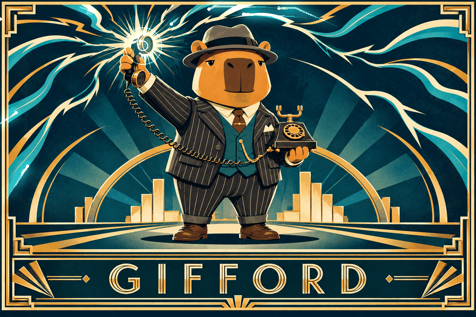
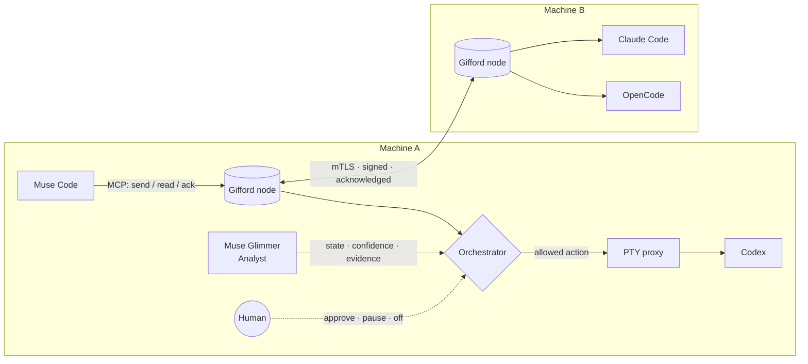

<h1 align="center">Gifford</h1>

<p align="center">
  
</p>

<h3 align="center">Agents talk. Glimmer understands. You hold the switch.</h3>

<p align="center">
The communication network for interactive coding agents.<br>
Gifford connects agents across harnesses, terminals, users and machines — with the human in the loop.
</p>

<p align="center">
  <a href="https://github.com/smellak/gifford/actions/workflows/ci.yml"></a>
  <a href="https://github.com/smellak/gifford/releases"></a>
  
  
  
</p>

<p align="center">
  <a href="#quick-start">Quick start</a> ·
  <a href="docs/federation-two-nodes.md">Federation</a> ·
  <a href="#the-glimmer-analyst">Glimmer Analyst</a> ·
  <a href="#measured-on-real-agents">Results</a> ·
  <a href="docs/DESIGN.md">Design</a>
</p>

> [!NOTE]
> **Release status:** `v0.1.0-rc.16` is a working Linux release candidate. The live
> message path has been exercised on four real harnesses and across two federated
> nodes. The task-specific Glimmer LoRA was trained, served and active at the
> recorded evidence cutoff through an operator override; its underpowered dataset
> did not pass the six-criterion selection gate.

---

## You are the message bus

You run Muse Code in one terminal, Codex in another and Claude Code on a remote
machine. They are capable agents, but you still copy plans, paste reviews and
search through terminals to discover which agent is idle, busy or waiting for
approval.

Gifford removes that manual relay:

```text
muse-1     send_message -> codex-1   "Review the payment refactor"
gifford    codex-1 is RUNNING_TOOL   -> defer
gifford    codex-1 is IDLE_AT_PROMPT -> deliver one notice
codex-1    [GIFFORD] 1 pending message
codex-1    read_message -> ack_message -> send_message
```

The message body stays in Gifford. The terminal receives only a short notice,
and only when the delivery policy and deterministic guards permit it.

No fork of the harness is required. Agents use MCP to send, list, read and
acknowledge messages; the same protocol works whether the last mile is a
generic terminal or a harness with native lifecycle events.

## Why Gifford exists

A shared mailbox lets agents exchange data, but it does not tell a recipient
that work is waiting. Blind terminal injection gets its attention, but cannot
tell whether a person is typing, a tool is running or an approval dialog is
open.

Gifford combines communication with the missing last mile:

| | Shared mailbox | Blind `tmux send-keys` | **Gifford** |
|---|:---:|:---:|:---:|
| Agents can exchange messages | Yes | Only prompt text | **Yes, through MCP** |
| The recipient is notified | Only when it polls | Yes | **Yes** |
| Understands recipient state | No | No | **Glimmer + deterministic evidence** |
| Protects an open human draft | Not applicable | No | **Yes** |
| Works across machines | Implementation-specific | No | **mTLS federation** |
| Authenticated agent identity | Implementation-specific | No | **Signed identity** |
| Human approvals, pause and off switch | Build it yourself | No | **Built in** |

In the keyboard-race benchmark, plain injection corrupted about 34% of lines.
The same 10,000 scenarios produced zero committed corruptions through Gifford.
See [the recorded results](docs/RESULTS.md).

## How it works



1. **MCP is the agent interface.** An agent sends, lists, reads and
   acknowledges through a small, harness-independent tool surface.
2. **The node stores and routes.** Messages are durable, addressed and tied to
   the authenticated agent that called the tool.
3. **The Analyst observes readiness.** Muse Glimmer classifies a redacted
   terminal window. Deterministic detectors corroborate readiness; native
   lifecycle events provide context but never authorize delivery by themselves.
4. **The Orchestrator chooses an allowed action.** Model output is advisory.
   Channel policy, approvals, process identity, draft protection and delivery
   guards remain deterministic.
5. **The proxy owns the terminal write.** It prepares, re-checks every guard
   and commits one short notice. A human keystroke aborts the attempt.
6. **Nodes federate.** Remote nodes authenticate with mTLS and exchange signed,
   acknowledged messages.

### Two last-mile modes

Gifford separates its harness-independent core from the last mile:

- **Generic PTY delivery — working today.** The proxy observes the terminal and
  delivers a one-line notice after all guards pass.
- **Native observation — available where the harness exposes it.** The
  [OpenCode plugin](adapters/opencode/README.md) and
  [Claude Code hooks](adapters/claude-code/README.md) emit content-free lifecycle
  events. They improve state evidence; they do not write to the terminal.

Native in-harness message delivery is not claimed in this release. If native
observation is absent or stops responding, Gifford keeps the generic path and
fails closed where evidence is insufficient.

## The Glimmer Analyst

Interactive coding agents do not expose one common API for their current
state. A person can glance at a terminal and tell whether an agent is free,
thinking, running a tool or asking for permission. Gifford gives that job to
the Analyst.

It recognizes seven states:

| Code | State | Typical action |
|:---:|---|---|
| `A` | `IDLE_AT_PROMPT` | Eligible for delivery |
| `B` | `THINKING_STREAMING` | Wait |
| `C` | `RUNNING_TOOL` | Wait |
| `D` | `WAITING_APPROVAL` | Hold for the human |
| `E` | `ASKING_QUESTION` | Hold for the human |
| `F` | `ERROR_OR_EXITED` | Hold and surface the condition |
| `G` | `UNKNOWN` | Fail closed |

The Analyst receives only a bounded, redacted terminal window and timing
features. If Gifford detects an open human draft, the screen is withheld from
the model and delivery is blocked before inference.

### A LoRA trained for agent-state analysis

`glimmer-analyst-v2` is a task-specific LoRA for Muse Glimmer 30B, trained on
real, labelled harness windows. On the 711-window comparison set:

| Metric | Base Glimmer | `glimmer-analyst-v2` |
|---|---:|---:|
| Accuracy | 0.743 | **0.893** |
| Macro F1 | 0.510 | **0.925** |
| False `SAFE` | 8 | **0** |
| False `IDLE` among 316 non-idle windows | 175 | **29** |

The exact public result is **89.3% on the comparison set of 711 windows;
coverage: claude-code, opencode, antigravity**. The dataset readiness status
was `underpowered`, so the six-criterion selection gate did not pass. Runtime
activation used the bounded operator-override path and therefore records
`gate_status=override`, not `passed`.

At the recorded evidence cutoff, the adapter was trained, served and active in
runtime as generation 6 with operational state `READY`. Those are separate
lifecycle facts, not a permanent deployment claim; `gifford ctl model status`
is the source of truth for the running node. Exact hashes, limits and the
breaker/reactivation cycle are in [`docs/ML_CONTRACT.md`](docs/ML_CONTRACT.md),
and the comparison boundary is in [`docs/RESULTS.md`](docs/RESULTS.md).

The model cannot write to a terminal, grant an approval, impersonate an agent
or override a guard. Its complete contract is in
[`docs/ML_CONTRACT.md`](docs/ML_CONTRACT.md).

## You hold the switch

The human remains part of the protocol, not an exception around it.

```sh
gifford panel

gifford ctl channel set off --yes --reason "operator stop"
gifford ctl pause codex-1
gifford ctl resume codex-1

gifford ctl link set muse-1 claude-1 require-approval
gifford ctl approvals --pending
gifford ctl approve <approval_id> --deliver-now

gifford ctl channel explain --from muse-1 --to claude-1
```

Policy is evaluated from the broadest channel state down to individual links
and agents. The strictest applicable rule wins. Queued work remains durable
when delivery is paused or switched off.

An approval request is not immediate. When the screen is withheld (the Proxy
cannot delimit the prompt safely) or the agent's state reads `STALE`,
`ASKING_QUESTION` or another transient phase, the node waits up to two
minutes for a current reading without asking anything, and only then opens
an approval for you; earlier releases asked after ten seconds. Delivery never
happens during that wait.

## Measured on real agents

The evidence below comes from real interactive sessions, not mock harnesses.
Commands, commits and limitations are recorded in
[`docs/RESULTS.md`](docs/RESULTS.md).

| Check | Recorded result |
|---|---|
| Live message path | **4/4 harnesses:** Codex, Claude Code, Muse Code and OpenCode |
| Multiple users on one node | **3/3** intended recipients; **0** attempts to the fourth account |
| Open human draft | **90** deferrals and **0** attempts until the Codex draft was cleared |
| Keyboard-race fuzzer | **0/10,000** corruptions through Gifford; plain injection corrupted about **34%** |
| Glimmer live, free agents | Delivery on all four; reads verified on Codex, Claude Code and OpenCode; Muse read unverified because the bench exhausted its quota |
| Glimmer live, visibly busy agents | **0** deliveries while Codex, Claude Code and OpenCode were visibly busy |
| Two-node federation | One committed and acknowledged message in each direction |
| Direct MCP artifact check | One encrypted 106-byte artifact decrypted with matching sender/recipient SHA-256 |

These results do not imply more than they measured. In particular, the full
four-harness human-keyboard matrix is not yet complete, and the recorded
artifact check is not evidence for cross-node artifact transfer.

## Quick start

### Install the Linux release candidate

```sh
gifford_installer="$(curl --fail --silent --show-error --location \
  --proto '=https' --proto-redir '=https' \
  https://raw.githubusercontent.com/smellak/gifford/v0.1.0-rc.16/scripts/install.sh)" &&
printf '%s\n' "$gifford_installer" |
  sudo sh -s -- --version v0.1.0-rc.16 --bin-dir /usr/local/bin --replace &&
gifford init && gifford doctor
```

The command downloads the versioned installer before running it, installs the
pinned release candidate, initializes Gifford and runs its diagnostic checks.
`--replace` updates an earlier Gifford binary in place; on a clean machine it
changes nothing. Without it, the installer refuses to overwrite an existing
binary, and the old version stays installed.

### Pin the measured harness versions

Gifford's terminal profiles and native observers are version-specific. Install
the measured versions before the first harness launch; an automatic update can
otherwise move the harness to the conservative generic profile.

```sh
# Claude Code 2.1.280. It auto-updates on first launch unless disabled.
curl -fsSL https://claude.ai/install.sh | bash -s 2.1.280
export DISABLE_AUTOUPDATER=1

# OpenCode 1.18.29. The installer takes a version and puts the binary in
# $HOME/.opencode/bin (it also edits the shell rc unless --no-modify-path).
# On a machine that already has OpenCode: opencode upgrade 1.18.29.
curl -fsSL https://opencode.ai/install | bash -s -- --version 1.18.29

# Muse Code 1.4.14-R7309.1: install it outside $HOME and start it with updates
# off. The public launcher only picks a channel (MUSE_CHANNEL), so the version
# is pinned by downloading the release artifact named in its manifest, checking
# the sha256 the manifest gives, and wrapping it. Installed under $HOME, Muse
# prints a sandbox warning in its footer that the Analyst reads as streaming
# text, and nothing is delivered to it.
MUSE_VERSION=1.4.14-R7309.1
MUSE_ARCH=x86_linux   # or aarch64_linux
MUSE_MANIFEST="https://lookaside.facebook.com/lookaside/muse/download/?channel=muse&version=$MUSE_VERSION&file=manifest.json"
read -r MUSE_URL MUSE_SHA256 < <(curl -fsSL "$MUSE_MANIFEST" |
  python3 -c "import json,sys;a=json.load(sys.stdin)['artifacts']['$MUSE_ARCH'];print(a['url'],a['checksum'])")
curl -fsSL -o "muse-bin-$MUSE_VERSION" "$MUSE_URL"
echo "$MUSE_SHA256  muse-bin-$MUSE_VERSION" | sha256sum -c
sudo install -m 0755 "muse-bin-$MUSE_VERSION" "/usr/local/bin/muse-bin-$MUSE_VERSION"
printf '#!/bin/sh\nexec /usr/local/bin/muse-bin-%s "$@"\n' "$MUSE_VERSION" |
  sudo tee /usr/local/bin/muse >/dev/null && sudo chmod 0755 /usr/local/bin/muse
export MUSE_NO_AUTO_UPDATE=1
```

The Muse artifact for `x86_linux` at that version is a static ELF binary of
414927192 bytes with sha256
`0809aac7cb58d18f5022b6d05e02aa1974683c0ec430e5f04d25b60ed17de2da`; the
manifest is the source of truth for every architecture, and the
`muse-stable` channel (`https://api.meta.ai/muse-code/channels/muse-stable`)
named that version on 2026-11-04.

Codex keeps its version with `check_for_update_on_startup = false` at the top
of `~/.codex/config.toml`, and OpenCode with `"autoupdate": false` in its
configuration (below): version 1.18.29 was observed moving to an unmeasured
version during the external judge rehearsal when updates were left enabled.
`gifford setup --all --apply` writes the Claude Code, Codex and OpenCode
settings for you; Muse Code reads only the environment variable.

For Codex, install both Linux executables from the same native release. The
`codex-code-mode-host` companion is required for MCP tools; without it Codex
reports `Code Mode is unavailable`.

```sh
CODEX_RELEASE=rust-v0.154.0
CODEX_TARGET=x86_64-unknown-linux-musl
CODEX_STAGE=$(mktemp -d)
for executable in codex codex-code-mode-host; do
  curl --fail --silent --show-error --location \
    --proto '=https' --proto-redir '=https' \
    "https://github.com/openai/codex/releases/download/${CODEX_RELEASE}/${executable}-${CODEX_TARGET}.tar.gz" \
    -o "$CODEX_STAGE/${executable}.tar.gz"
  tar -xzf "$CODEX_STAGE/${executable}.tar.gz" -C "$CODEX_STAGE"
  sudo install -m 0755 "$CODEX_STAGE/${executable}-${CODEX_TARGET}" \
    "/usr/local/bin/${executable}"
done
```

### Start a node and one agent

```sh
gifford up
gifford status

gifford run --agent claude-1 --harness claude-code -- claude

# In another terminal
gifford panel
```

Stop the node with `gifford down`. For a shared system node or agents already
running inside tmux, follow [`docs/system-node.md`](docs/system-node.md).

### Connect each harness to Gifford (MCP)

Some harnesses start their MCP servers with a filtered environment (Codex
0.154.0 and Muse Code 1.4.14 drop `XDG_RUNTIME_DIR`), so `gifford mcp` does
not rely on the environment to find the hub: the hub records the socket it
serves in `hub.addr` under its data directory, and the client tries, in
order, its own runtime directory, that record, `/run/user/<uid>/gifford` and
the data-directory fallback. `gifford doctor` names the directories.

The MCP server is always the local Gifford binary. One command connects every
harness `gifford setup` supports (Claude Code, Codex, OpenCode and Muse Code)
that it finds on `PATH`; Antigravity has a measured PTY profile but no setup
recipe:

```sh
gifford setup --all --dry-run   # list each harness, its version and every change
gifford setup --all --apply     # back up, merge, register, then check the MCP server
gifford setup --check           # check again once `gifford up` is running
gifford setup --undo            # restore the files of the last run
```

The report shows each harness as `MEASURED` (automatic delivery possible) or
`UNMEASURED` (every delivery waits for your approval). `--apply` merges into
existing files without removing anything and asks before it pre-approves
Gifford's four message tools; `--approve-tools` or `--no-approve-tools`
answers in advance. The sections below are the same changes by hand. Launch
each harness through `gifford run` as shown above.

**Claude Code 2.1.280**

```sh
claude mcp add --scope user gifford -- /usr/local/bin/gifford mcp
DISABLE_AUTOUPDATER=1 \
  gifford run --agent claude-1 --harness claude-code -- claude
```

Also merge the observe-only hooks from
[`adapters/claude-code/README.md`](adapters/claude-code/README.md) into the
Claude Code settings file.

Pre-approve exactly Gifford's four message tools in the same settings file
(`~/.claude/settings.json`). Allow rules resolve before auto mode's
classifier, so Claude Code neither asks nor lets auto mode deny these calls;
every other tool keeps its usual rules:

```json
{
  "permissions": {
    "allow": [
      "mcp__gifford__send_message",
      "mcp__gifford__list_pending_messages",
      "mcp__gifford__read_message",
      "mcp__gifford__ack_message"
    ]
  }
}
```

**Codex 0.154.0**

Add this to `~/.codex/config.toml`. The first line must stay above every
table. The four `tools` tables pre-approve exactly Gifford's four message
tools; every other tool keeps asking:

```toml
check_for_update_on_startup = false

[mcp_servers.gifford]
command = "/usr/local/bin/gifford"
args = ["mcp"]

[mcp_servers.gifford.tools.send_message]
approval_mode = "approve"

[mcp_servers.gifford.tools.list_pending_messages]
approval_mode = "approve"

[mcp_servers.gifford.tools.read_message]
approval_mode = "approve"

[mcp_servers.gifford.tools.ack_message]
approval_mode = "approve"
```

Without these tables Codex asks before every call; choose **Always allow** for
each of the four. A per-call prompt prevents unattended collaboration.

Codex does not act on the notice line by itself. Tell it what the notice means
in its global instructions file:

```sh
mkdir -p "$HOME/.codex"
cat >>"$HOME/.codex/AGENTS.md" <<'GIFFORD'
When a line beginning with [GIFFORD] or : [GIFFORD] appears in your input,
messages are waiting for you. Call the gifford MCP tools: list_pending_messages,
then read_message for each message, then ack_message with status ACKNOWLEDGED,
and reply with send_message unless the message says no response is needed.
GIFFORD
```

Merge the hook configuration from
[`adapters/codex/README.md`](adapters/codex/README.md) into
`~/.codex/hooks.json`, then review it with `/hooks`.

**OpenCode 1.18.29**

Merge this object into `~/.config/opencode/opencode.json`. OpenCode also reads
`opencode.jsonc` from the same directory, and that file wins where both set a
key, so `gifford` and `autoupdate` must not be set differently there:

```json
{
  "$schema": "https://opencode.ai/config.json",
  "autoupdate": false,
  "mcp": {
    "gifford": {
      "type": "local",
      "command": ["/usr/local/bin/gifford", "mcp"],
      "enabled": true
    }
  }
}
```

Install the native-events plugin from the checkout:

```sh
install -d -m 0700 "$HOME/.config/opencode/plugins"
install -m 0600 \
  /absolute/path/to/gifford/adapters/opencode/gifford-native-events.js \
  "$HOME/.config/opencode/plugins/gifford-native-events.js"
```

**Muse Code**

Merge this object into `~/.config/muse/settings.json`. Muse refuses a settings
file without `schema_version`, and its rotating prompt hint must be off: the
hint is drawn on the empty prompt row, Gifford reads it as a draft and
withholds every delivery while it shows:

```json
{
  "schema_version": 1,
  "tui": {
    "prompt_hint_enabled": false
  },
  "mcpServers": {
    "gifford": {
      "type": "stdio",
      "command": "/usr/local/bin/gifford",
      "args": ["mcp"]
    }
  }
}
```

Install, approve and enable the observe-only adapter:

```sh
muse plugins install /absolute/path/to/gifford/adapters/muse --scope user
muse plugins approve gifford-muse-adapter
muse plugins enable gifford-muse-adapter
```

The adapter commands above improve lifecycle evidence. The generic PTY path
still works when an adapter is absent or fails closed.

### Connect two nodes

Federation needs two Gifford commands after both nodes can reach A on port
`7443`. First, derive A's certificate fingerprint on A:

```sh
NODE_A_FINGERPRINT=$(openssl x509 \
  -in "${XDG_DATA_HOME:-$HOME/.local/share}/gifford/keys/node-tls.pem" \
  -outform DER | openssl dgst -sha256 -r | awk '{print $1}')
```

1. On A, create a one-use ten-minute enrollment token in a private file. This
   uses Python 3, not `jq`, and never puts the token in argv:

```sh
TOKEN_FILE=$(mktemp)
chmod 0600 "$TOKEN_FILE"
gifford node enroll-token --org org-b --ttl 10m |
  python3 -c 'import json,sys; print(json.load(sys.stdin)["token"])' \
  >"$TOKEN_FILE"
```

2. Transfer the file to B through an approved secret channel, preserving mode
   `0600`, then join A from B:

```sh
gifford node join https://node-a.example.invalid:7443 \
  --fingerprint "$NODE_A_FINGERPRINT" --token-file "$TOKEN_FILE"
```

Set `organization_id: org-b` in B's Gifford `config.yaml`, restart B's hub and
confirm `gifford node peers` reports `TRUSTED`. Enrollment establishes trust;
each node also needs an explicit `allow` rule in
`${XDG_CONFIG_HOME:-$HOME/.config}/gifford/policies/federation.yaml` for each
of its local agents that the other node may deliver to, otherwise federation
fails closed. On A, allowing B to deliver to the local agent `codex`:

```yaml
schema_version: 1
rules:
  - id: allow-node-b-codex
    effect: allow
    peer: node-b
    action: deliver_message
    agent: codex
```

On B, the mirror rule names A's node id and B's local agent. The complete
copy-paste procedure, both policy files and the verification commands are in
[`docs/federation-two-nodes.md`](docs/federation-two-nodes.md).

### Enable the Glimmer Analyst (optional)

Without this section a node runs the deterministic route only. The Analyst
needs an inference endpoint that serves Glimmer with the published adapter
(see [`ml/serve/README.md`](ml/serve/README.md)). The endpoint URL and its
token are never written into a config file or passed in argv: the gateway
file names two environment variables, and the hub reads them at start.

1. Put the token in a private file and export both variables in the shell
   that starts the hub:

```sh
GLIMMER_TOKEN_FILE="${XDG_CONFIG_HOME:-$HOME/.config}/gifford/glimmer.token"
chmod 0600 "$GLIMMER_TOKEN_FILE"
export GLIMMER_URL="https://glimmer.example.invalid/v1"
read -r GLIMMER_TOKEN <"$GLIMMER_TOKEN_FILE"; export GLIMMER_TOKEN
```

2. Write `${XDG_CONFIG_HOME:-$HOME/.config}/gifford/gateway.yaml`, mode
   `0600`. The adapter is published at
   <https://huggingface.co/smellak/gifford-glimmer-analyst-v2>; its name,
   revision and sha256 are the ones in its model card, section "Node
   configuration values" (the same section is in
   `docs/huggingface/MODEL_CARD.md`). The three contracts are required:

```yaml
endpoint:
  url_env: GLIMMER_URL
  token_env: GLIMMER_TOKEN
base_model:
  repo: <base model repo>
  revision: <base model revision>
runtime: vllm
profiles:
  - contract: ANALYZE_AGENT_STATE
    inference_profile: analyst-lora
    adapter_name: glimmer-analyst-v2
    adapter_revision: <adapter revision>
    adapter_sha256: <adapter sha256>
  - contract: TRIAGE_MESSAGE
    inference_profile: base
  - contract: CHOOSE_ORCHESTRATION_ACTION
    inference_profile: base
```

3. Add the two sections to Gifford's `config.yaml` and restart the hub. The
   profile and calibration revisions, digests, temperature and threshold are
   the ones in the same "Node configuration values" section of the model
   card;
   `unsafe_phase_limit` is the calibrated bound under which the detector may
   corroborate an idle reading below the threshold (0.25 on the four
   measured harnesses; 0 turns corroboration off):

```yaml
ml:
  screen_lines: 20
  mask: none
state_analysis:
  gateway_config: /home/<user>/.config/gifford/gateway.yaml
  profile_revision: <profile revision>
  profile_sha256: <profile sha256>
  calibration_revision: <calibration revision>
  calibration_sha256: <calibration sha256>
  temperature: <calibrated temperature>
  idle_threshold: <calibrated threshold>
  unsafe_phase_limit: 0.25
```

4. Activate the adapter. A fresh hub starts on the **base model**: before
   `gateway.yaml` exists, `gifford ctl model status` prints `active_profile`
   `null` and every deployment field `unavailable`; once the gateway is
   configured it shows generation 1 as `READY base`. The base model is
   not the Analyst that was validated. The adapter's gate did not pass, so it
   is activated through the bounded operator override with the evidence
   bundle published under `evidence/` in the adapter's Hugging Face
   repository, <https://huggingface.co/smellak/gifford-glimmer-analyst-v2/tree/main/evidence>:
   `evidence.json`, which references by relative path and sha256
   `model_adapter_metadata.json`, `model_training_run_metadata.json` and
   `evaluation-report.json`, plus `SHA256SUMS`. Download the directory,
   check it, then activate:

```sh
cd evidence && sha256sum -c SHA256SUMS
gifford ctl model activate-override "$PWD/evidence.json"
gifford ctl model status
```

`status` must then show the adapter `ACTIVE` with `gate_status=override`.
Until this step the Analyst is the base model, whatever `gateway.yaml` says.

The Analyst only advises and vetoes: an unmeasured harness stays on approval
whatever it answers, and every delivery still passes the deterministic
guards.

### Measured harness profiles

| Harness | Measured version | Live message path | Native integration | Before first use |
|---|---|:---:|:---:|---|
| Muse Code | `1.4.13-R6996.1`, `1.4.14-R7309.1` | Yes | Measured terminal profile | `tui.prompt_hint_enabled: false` in settings.json (`gifford setup` sets it); install Muse outside `$HOME` |
| Claude Code | `2.1.280` | Yes | Hooks | — |
| Codex | `0.154.0` | Yes | Observe-only hooks | Run the native binary, not the npm launcher |
| OpenCode | `1.18.29` | Yes | Native-events plugin | Set `autoupdate: false`; send one prompt first |
| Antigravity | `1.4.8` | Profile available; not part of the accepted four-harness run | Observe-only hooks | Allow Gifford's four MCP tools |

Profiles are version-specific. An unknown or changed terminal shape is not
silently treated as safe; Gifford holds delivery when it cannot establish the
required evidence. Detailed setup notes are under [`adapters/`](adapters/)
and in [`docs/system-node.md`](docs/system-node.md). The generated source of
truth is [`docs/COMPATIBILITY.md`](docs/COMPATIBILITY.md).

## Send a file

Artifact commands must run inside the sending or receiving agent's process
tree. Transfers are encrypted end to end, resumable and hash-verified.

```sh
gifford artifact send ./report.pdf --to reviewer --purpose "review"
gifford artifact list
gifford artifact receive art-0123456789abcdef0123456789abcdef --out ./downloads
gifford artifact status art-0123456789abcdef0123456789abcdef
```

The accepted release evidence covers the direct MCP artifact path. Cross-node
artifact delivery should not be advertised until its own live check is
recorded.

## Security and privacy boundaries

- Message identities are signed; federated node links use mTLS.
- Message bodies are **not** end-to-end encrypted in this release. Artifacts
  are.
- The model sees only bounded, redacted input after the deterministic draft
  guard has closed.
- Native observers emit lifecycle signals, not terminal contents.
- The model proposes; deterministic guards and human policy dispose.
- The project supports Linux in this release candidate.

The authoritative built/not-built boundary is
[`docs/DESIGN.md`](docs/DESIGN.md).

## Built by the agents it connects

Gifford was developed by **Muse Code, Codex and Claude Code**, directed and
integrated by a human meta-orchestrator during the Meta Global AI Dev Hackathon
(October 27 – November 4, 2026).

| Harness | Provider | Project commit identity |
|---|---|---|
| Muse Code | Meta | [`gifford-muse-agent[bot]`](https://github.com/apps/gifford-muse-agent) |
| Codex | OpenAI | [`gifford-codex-agent[bot]`](https://github.com/apps/gifford-codex-agent) |
| Claude Code | Anthropic | [`gifford-claude-agent[bot]`](https://github.com/apps/gifford-claude-agent) |

Those identities are GitHub Apps owned by this project, not vendor accounts.
See [`AUTHORS.md`](AUTHORS.md).

## Documentation

- [`docs/DESIGN.md`](docs/DESIGN.md) — architecture and exact release boundary
- [`docs/RESULTS.md`](docs/RESULTS.md) — measured commands, commits and limitations
- [`docs/ML_CONTRACT.md`](docs/ML_CONTRACT.md) — Analyst inputs, outputs and invariants
- [`docs/FREEZE.md`](docs/FREEZE.md) — frozen contracts and enforcement
- [`docs/native-adapters.md`](docs/native-adapters.md) — native capability model
- [`docs/pane-locks.md`](docs/pane-locks.md) — cooperative terminal ownership
- [`docs/system-node.md`](docs/system-node.md) — one shared node per machine
- [`docs/federation-two-nodes.md`](docs/federation-two-nodes.md) — enroll and verify two federated nodes
- [`CONTRIBUTING.md`](CONTRIBUTING.md) — development and authorship rules

## License

Gifford is licensed under [Apache-2.0](LICENSE). Third-party notices are in
[`NOTICE`](NOTICE). Muse Glimmer and the trained adapter retain their own model
and artifact terms; this repository does not redistribute the base-model
weights.

---

<p align="center">
  <b>Agents talk. Glimmer understands. You hold the switch.</b>
</p>
